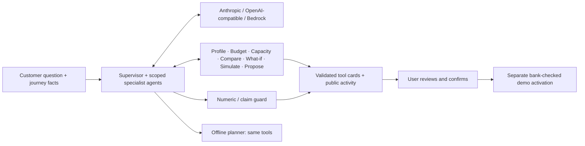
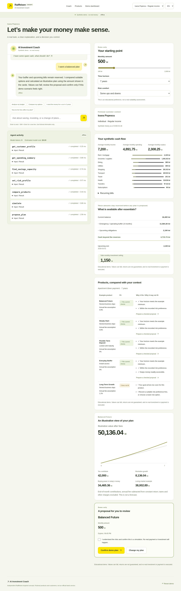

# Hackathon submission — AI Investment Coach

An educational agent for Raiffeisen NEXXT VibeHack, **AI for Scaling & Growth / Track 1**. It helps fictional individuals and a bakery business understand spending, protect essential cash, compare products and prepare a plan they explicitly confirm. It is an independent concept, not an official bank service.

The model can call validated tools to investigate a customer, compare options, simulate a plan and handle a changed goal. The budget, capacity and product decisions use actual deterministic calculations over seeded synthetic histories. A first-class offline planner uses the same tools when no provider is selected or inference fails. Every answer shows its actual `agent` or `offline` mode.



The application reads verified profile/budget/capacity context before the model acts. Model-selected comparisons, changes, simulations and proposals remain visible in the activity panel; the trace identifies which calls were application initiated. This is tool orchestration, not a claim that every step is chosen by the model.

**Real:** provider calls when configured, validated tools, calculations, immutable proposals, server-side checks, confirmation endpoint, audit, responsive UI and measurements. **Mocked:** all customers, transactions, products, account access, OTP, adviser handoff and activation. No real account is opened and no real money moves. Return and fee assumptions are illustrative, not forecasts. The model never receives a money-movement tool.

## Specialist orchestration

A supervisor now coordinates **budget → products → planning → coordinator**, with independent role prompts, scoped tools and isolated tool transcripts. Specialists share verified results; only the coordinator publishes the final reply. The team shares the existing per-turn timeout, token and iteration limits, and every plan still requires separate user confirmation.

Orchestration is enabled by default (`AGENT_ORCHESTRATION=1`). In **Agent activity**, inspect the specialist team, handoffs, model-call counts and tool ownership. Offline mode runs the same tool workflow and explicitly reports zero model calls. Set `AGENT_ORCHESTRATION=0` and restart to use the previous single-agent loop. No dependencies or additional services are needed.

See [ORCHESTRATION.md](docs/ORCHESTRATION.md) for permissions, context boundaries, failure behavior and verification.

## Run in 60 seconds

Use Node **20+** and npm. There are no runtime/dev dependencies, framework or build step.

```sh
git switch agent-upgrade
npm ci
npm test
npm start
```

The single Node server serves both the UI and API on port **5173** (`PORT` changes it). On your own computer, open your browser at that port. `npm run dev` uses Node's watch mode. No database, Docker, Vite, separate frontend process or build command is needed. Data persists in the server's memory until restart; browser sessions use an HttpOnly cookie.

To configure a provider, copy `.env.example` to the ignored `.env` (`cp .env.example .env`; PowerShell: `Copy-Item .env.example .env`). Do not overwrite an existing file with credentials. Fill in values locally, keep secrets out of Git, then restart. Existing process environment values take precedence. Windows may hide filename extensions: the actual filename must be `.env`, not `.env.example` or `.env.txt`.

| Provider | Configuration |
|---|---|
| Offline (default) | `AGENT_PROVIDER=offline`; no key needed |
| Anthropic Messages | `AGENT_PROVIDER=anthropic`, `AGENT_ANTHROPIC_API_KEY`, optional `AGENT_MODEL` |
| OpenAI-compatible | `AGENT_PROVIDER=openai`, `AGENT_OPENAI_API_KEY`, `AGENT_OPENAI_BASE_URL`, `AGENT_MODEL` |
| Existing Bedrock API key | `AGENT_PROVIDER=bedrock`, `AWS_BEARER_TOKEN_BEDROCK`, `AWS_REGION=us-west-2`, `BEDROCK_MODEL_ID=us.amazon.nova-lite-v1:0` |

For stronger Bedrock tool use, the explicitly tested alternative is `AGENT_MODEL=us.amazon.nova-pro-v1:0`; model access and cost differ. Setting a model does not change the provider. The compatible base URL defaults to `https://api.openai.com/v1`; a local compatible endpoint can use a loopback HTTP URL. Keys and provider requests remain server-side. This prototype uses Bedrock bearer API keys; IAM/SigV4 roles are not implemented.

Run `npm run provider:test` (or `npm run bedrock:test`) for one short live request. A connection success establishes access, not agent quality. Configure `AGENT_INPUT_USD_PER_MILLION` and `AGENT_OUTPUT_USD_PER_MILLION` for explicit cost estimates; blanks mean **unknown**, not free. Other controls are documented in [.env.example](.env.example). Cloud credentials do not transfer to your computer.

Cloud network settings must allow the selected provider hostname (`api.anthropic.com`, `api.openai.com`, your compatible endpoint, or `bedrock-runtime.us-west-2.amazonaws.com`). A saved environment draft is not applied until reviewed, saved and published. Cloud onboarding does not provide a browser preview link; local HTTP checks and throwaway browser tests validate the app internally.

## Amazon Bedrock API key setup

### Get a key from AWS

1. Sign in to the [Amazon Bedrock console](https://console.aws.amazon.com/bedrock/) and select **US West (Oregon) — `us-west-2`**.
2. Open **API keys** in the left navigation. For a temporary session, select **Short-term API keys → Generate short-term API keys**. These expire with your AWS session, after at most twelve hours. For this exploration/demo, you can instead use **Long-term API keys → Generate long-term API keys**, choose an expiration and generate the key. AWS recommends long-term keys only for exploration.
3. Copy the generated **Bedrock API key** and keep it private. Generate it in the same region the app uses. Your AWS identity/key must have permission to invoke the chosen model or inference profile.

This app accepts a Bedrock bearer API key. An AWS access-key ID / secret-access-key pair or an IAM role is not supported by this adapter. See the [official AWS API key instructions](https://docs.aws.amazon.com/bedrock/latest/userguide/api-keys.html) for key generation, permissions and expiration.

### Put the key in your local `.env`

From the repository root, create `.env` only if it does not already exist:

**Windows PowerShell**

```powershell
if (-not (Test-Path .env)) { Copy-Item .env.example .env }
notepad .env
```

**macOS / Linux**

```sh
if [ ! -f .env ]; then cp .env.example .env; fi
```

Open `.env` in your editor and set these values, replacing the placeholder with your actual key:

```dotenv
AGENT_PROVIDER=bedrock
AGENT_ORCHESTRATION=1
AWS_REGION=us-west-2
AWS_BEARER_TOKEN_BEDROCK=paste_your_bedrock_api_key_here
AGENT_MODEL=us.amazon.nova-pro-v1:0
```

Nova Pro is the model used for the specialist orchestration evaluation. If your account cannot use it, choose a supported Converse-compatible model/profile. To use the Nova Lite default from `.env.example`, leave `AGENT_MODEL=` empty and keep `BEDROCK_MODEL_ID=us.amazon.nova-lite-v1:0`. A nonempty `AGENT_MODEL` takes precedence over `BEDROCK_MODEL_ID`; changing only the latter will not override it.

On Windows, enable **View → Show → File name extensions** in File Explorer and verify the file is named exactly `.env`, not `.env.example` or `.env.txt`. `.env` is ignored by Git. Keep the key server-side; do not put it in browser code, screenshots or commits.

### Test the connection and run the app

```sh
npm ci
npm run bedrock:test
npm start
```

The connection test sends one small billable model request and should print **Provider connection succeeded.** It hides the key. Then use the app on port **5173** on your computer, select a fictional persona, and ask “I want a balanced plan”. **Agent activity → Your specialist team** shows the roles, model calls and actual answer mode.

Stop the server with **Ctrl+C** and restart it after editing `.env`. Existing terminal/cloud environment variables override `.env`. The app does not automatically refresh an expired key: replace it and restart. A successful connection test proves model access; chat can still switch to the labelled offline workflow if a tool turn times out or fails validation.

| Problem | What to check |
|---|---|
| No provider configured / always offline | Set `AGENT_PROVIDER=bedrock`, verify the actual filename is `.env`, and restart. Check whether an existing environment variable overrides your edit. |
| HTTP 401/403 or a region-scope error | Check key expiration, the key's region (`us-west-2` here), and permission to use the selected model/profile. |
| HTTP 400/404 | Check the model/profile ID and its availability in your account/region; also check the `AGENT_MODEL` override. |
| Connection test passes, chat falls back | Inspect **Agent activity** for the failed stage. Nova Pro is the tested orchestration model; an accessible model may still perform differently with tools. |

### Use the key in the cloud workspace

In environment settings, reuse or add the **secret** `AWS_BEARER_TOKEN_BEDROCK` with destination **`bedrock-runtime.us-west-2.amazonaws.com`**. Set the non-secret variables `AGENT_PROVIDER=bedrock`, `AWS_REGION=us-west-2`, `AGENT_ORCHESTRATION=1` and your chosen `AGENT_MODEL`. Apply the settings and restart the server. If the environment requires publication, review, save and publish the configuration as instructed by its settings UI.

Cloud secret bindings stay in the cloud environment. For a clone on your computer, use an actual key from the AWS console in your local `.env`; do not copy a cloud proxy placeholder. The browser never needs the key.

## Three-minute demo script

Use `/coach`; keep **Agent activity** open. The persona switcher starts a separate fictional session. The language switch supports English and Romanian and defaults to the browser language.

1. **0:00–0:55 — Ioana:** select Ioana. Send “I have some spare cash, what should I do?” Show budget, essential buffer, upcoming rent and idle cash. Answer the risk question with “I want a balanced plan”. Review comparison, projection and checked proposal. No plan is activated yet.
2. **0:55–1:25 — Change of mind:** send “I need the money for a car in 2 years”. Show the before/after change card and funds excluded by the shorter horizon. Review the new liquid-savings proposal; tick the risk/demo acknowledgment and press **Confirm demo plan**. The success page explicitly says no real money moved.
3. **1:25–1:55 — Andrei:** select Andrei; ask “Can I afford to invest?” Show the unfunded buffer, specific subscriptions, first savings milestone and the small savings habit. No fund is offered.
4. **1:55–2:20 — Mihai:** select Mihai; ask about irregular income and the tax bill. Show the tax reserve and larger buffer. Answer “I prefer a steady plan” to see a small fund allocation while reserves stay liquid.
5. **2:20–2:45 — Elena:** select Elena; send “Make a plan for our bakery surplus”. Show operating/payroll reserves and staggered business deposit maturities.
6. **2:45–3:00 — Evidence:** switch to RO to show translated controls; open `/admin` for funnel, mode split, tool usage, costs and confirmation conversion. State whether the current answer is agent or offline and which provider is configured.

The offline version runs the whole script without a key. Live models may fall back safely; the mode badge reports that truthfully. The recorded `specialist-supervisor-v4` run with Nova Pro passed **39/40 scenarios (97.5%)**, including **14/14 safety cases**. One business-plan case chose an eligible cash product instead of the expected deposit ladder. Anthropic and OpenAI live quality is not established without their credentials.

## Validation and measured evidence

```sh
npm test
npm run eval
npm run eval -- --live
npm run loadtest
```

- `npm test`: **129/129** regression, safety, provider, HTTP and orchestration tests.
- [Evaluation report](docs/EVAL_REPORT.md): forty scenarios, including fourteen safety scenarios; scripted **40/40 overall and 14/14 safety**. Live Bedrock Nova Pro: **39/40 (97.5%) overall, 14/14 safety**, averaging **4.91 seconds per conversation**. Exact failures, role/model-call counts, latency and unpriced cost are reported separately. A fallback is a live quality failure.
- [Scale report](docs/SCALE.md): actual HTTP, one hundred complete journeys, twenty concurrent, zero errors; approximately **799 requests/s**, **42 ms p95** in the recorded short loopback run. This excludes model/network/database latency and is not production capacity.
- [REPORT.md](REPORT.md): work package evidence, checklist, real output, browser/accessibility checks and deviations.
- [Architecture](docs/ARCHITECTURE.md): trust boundaries, capacity assumptions, failure handling and storage/scale limits.
- [Baseline differences](docs/BASELINE.md): the supplied brief described another repository. The actual baseline's React/Vitest tests and sources are archived in `legacy/react/`; their behavior is ported to dependency-free Node tests. The nonexistent “previous 23 tests” and five products are not claimed to have existed.

## Interface and API

Monthly controls are separate from chat. Draft a question while an answer is pending; Stop cancels the pending request. SSE streams public tool actions, then the guarded final paragraph; it does not stream hidden reasoning or unchecked prose. Cards render tool payloads, including category bars, reserve deductions, comparison reasons, cash/stress projections and proposal confirmation. Labels use synthetic-data disclosures throughout.

| Route | Purpose |
|---|---|
| `/`, `/coach` | Landing, anonymous educational guide, persona analysis and tool cards |
| `/onboarding`, `/onboarding/new-account`, `/onboarding/login` | Ordered fictional access flow, limited demo OTP and preserved explicit choices |
| `/account/invest`, `/account/plan`, `/account/success` | Comparison, review, explicit demo confirmation and downloadable plan |
| `/admin` | Aggregate synthetic funnel and agent metrics, privacy-limited audit |
| `POST /api/agent` | `{message}` → `{messages,cards,trace,mode,usage}`; JSON or fetch/SSE |
| `POST /api/coach`, `/api/chat` | Compatibility aliases retaining `text` and `source` |
| `POST /api/proposals/:id/confirm` | Only activation endpoint; immutable owned proposal and `{confirm:true}` required |
| `GET /api/health` | Configuration readiness; not proof of model access |

Session-scoped tools cannot choose another customer. The bank checks suitability and capacity on proposal and confirmation, including existing allocations, scenario revisions and expiry. Input/rate/token/time limits and an answer guard provide layered controls. Unknown figures are retried once, then replaced by the offline tool-backed explanation. Logs exclude messages, customer names and tool arguments. In demo mode the dashboard is public; outside demo mode it requires `ADMIN_TOKEN`. This is a synthetic prototype, not production banking software.


