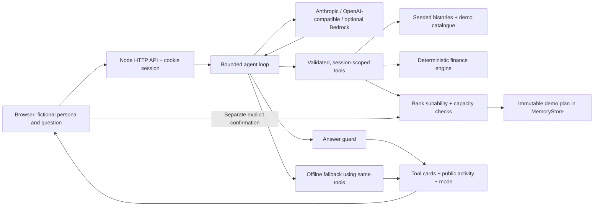

# Architecture and trust boundaries

The active application is CommonJS and browser JavaScript using Node 20+ built-ins. There are no runtime or development dependencies and no build step. `legacy/react/` archives the original implementation and test sources; it is not served or installed.

## Components and ownership

| Component | Responsibility |
|---|---|
| `server.js` | Same-origin HTTP, static assets, session cookies, input/rate/concurrency limits, SSE and JSON routes, ordered demo onboarding, admin access |
| `src/data/` | Seeded historic synthetic transactions, four immutable personas, recurring expenses and obligations |
| `src/products.js`, `src/engine.js` | Fictional product facts; monthly annuity, fees, inflation and stress examples |
| `src/tools/` | Closed input schemas, scoping, sanitized untrusted labels, deterministic analysis, UI payloads and decision audit |
| `src/agent/` | Specialist supervisor, role scopes, provider adapters, versioned system instructions, bounded model/tool exchange, fallback and trace |
| `src/llm.js` | Numeric grounding (including Romanian formatting), rate-specific percentage checks, unsafe claim checks, removal of thinking blocks |
| `src/bank.js` | Proposal immutability, expiry, suitability, capacity, ownership and fresh checks at confirmation |
| `src/store.js` | Replaceable storage boundary for session facts, proposals, plans, audit and scoped bounded read cache |
| `public/`, `src/i18n/` | Accessible responsive UI and English/Romanian copy; browser renders the tool's `ui` data |
| `eval/`, `scripts/loadtest.js` | Real loop fixtures and actual HTTP concurrent-journey measurements |

## Specialist supervisor

The default entry point is `src/agent/orchestrator.js`. It reuses the bounded `agentTurn` execution engine, assigning independent budget, product, planning and coordinator prompts defined in `specialists.js`. All roles use the configured provider/model. Their tool transcripts are isolated by server-side ownership tags; a current-turn verified board carries financial results between them. Guard-rejected specialist prose is kept out of other roles' messages.

Tool permissions are enforced before execution, and planning tool schemas require an explicit eligible product and affordable contribution ceiling. The supervisor shares one global deadline/token/exchange budget across all roles. It publishes stage/handoff metadata without private findings or hidden reasoning. Offline execution identifies the same functional roles with zero model calls. `AGENT_ORCHESTRATION=0` retains the prior single-agent path. See [ORCHESTRATION.md](ORCHESTRATION.md) for the complete routing and trust model.

## A turn

The server strips control characters, caps text, rejects concurrent turns in a session, and checks the per-session request budget. Preflight refuses attacks, cross-customer requests, unsafe demands and off-topic questions without sending them to a model. Tax/legal questions offer a simulated adviser handoff.

For an authenticated live turn, the application obtains the profile, spending and capacity with the same scoped tools and records an explicit risk choice if present in the user's words. These trace entries are marked `verified-context` / `explicit-user-answer`, so they are distinguishable from model-selected calls. The model then chooses comparisons, hypothetical changes, simulations and proposals from the remaining permitted actions. Completed context reads and mutations are removed from the advertised tools; a requested change must run before a new comparison/proposal. A successful what-if refreshes the capacity card through the same tool. This initial context collection is deterministic; the entire application is not claimed to be model-directed. The activity panel shows actions and summaries, never hidden model reasoning.

The adapter interface is `complete({system,messages,tools,signal}) → {text,toolCalls,usage}`. Anthropic Messages and OpenAI-compatible Chat Completions use native structured calls/results. Bedrock Converse remains as a third adapter for the previously configured API key. HTTP CONNECT honors the cloud proxy and trusted CA without disabling TLS verification. API keys stay on the server. Local OpenAI-compatible HTTP is permitted only for loopback addresses.

Each turn caps provider exchanges at six, calls per response at twelve, total reported tokens at a configurable budget (default forty thousand), and wall time at twelve seconds. Usage includes rejected replies. The model gets the last twelve conversation messages plus current journey facts and compact tool data; large chart series stay in cards. A skipped required workflow gets one corrective instruction within the same limits. Unsupported numbers or unsafe claims get one answer repair. Both repairs consume the original budget.

Only a guarded final paragraph is published; tool events can stream earlier over fetch/SSE. Unknown pricing stays unknown. A timeout, provider error, iteration/token limit or repeated guard rejection calls the deterministic offline planner through the same tools and renders the same card types. The result's actual `mode` is displayed. No silent offline answer counts as live evaluation success. Cancellation aborts a pending provider request and does not run fallback mutations.

## Financial decisions

Capacity is deliberately conservative and illustrative, not a regulated suitability assessment. Regular-income people reserve three months of essentials plus upcoming obligations; irregular earners reserve six. Business accounts reserve three months of operating essentials, payroll and upcoming inventory. Regular income uses its mean; irregular/seasonal income uses the lower quartile. Half the remaining conservative monthly surplus is rounded down to an allowed contribution step and capped. Existing activated contributions also count against the bank limit.

Andrei's unfunded buffer blocks all funds, permitting only the affordable savings habit shown by capacity. Subscription cuts and a first one-month target are explicit. Mihai's tax bill stays reserved. Elena's ladder uses only remaining one-off business surplus, rounded down across staggered maturities; it is not a recurring fund contribution. Ioana's funded buffer permits an appropriate fund after an explicit risk choice. These are deterministic educational policies, not real bank product rules.

Every proposal checks segment, recorded risk, horizon, liquidity, buffer, monthly limits and existing allocations. A goal change immediately limits the effective horizon even if the provider fails before applying `what_if`. What-if bonus/rent changes must match the user's actual request and are idempotent within a turn, including provider-to-offline fallback.

The agent can only call `propose_plan`. The proposal is frozen, session/persona/revision bound and expires after ten minutes. Only `POST /api/proposals/:id/confirm` with `{confirm:true}` activates a demo plan. The endpoint rejects edited amounts and repeats suitability/capacity checks; repeated confirmation is idempotent. It never calls a payment or investment service. Browser risk acknowledgment is an additional UI step, not a substitute for server checks.

## Trust and failure boundaries

Customer selection is a demo shortcut, not authentication. The server chooses the customer from its session; tool inputs cannot choose another customer. Merchant/profile labels are untrusted, sanitized and placed in tool data, never system instructions. JSON/HTML are escaped in the browser. Audit stores only conversation UUID, fictional persona ID, action, decision, timing, usage/cost and reason codes; it excludes messages and tool arguments. The simulated adviser handoff remains in the private session and is never sent externally.

The numeric guard checks tool-derived amounts/rates and rounded display forms, not natural-language financial truth in general. It cannot prove that every interpretation is correct. Tool cards remain authoritative; locked-money and market risk are shown as product facts. Prompt injection defenses and claim patterns are layered safeguards, not a claim of perfect language understanding.

All server state is in memory and resets on restart. Audit is bounded, read cache is bounded and revision scoped, but session/proposal lifetime cleanup is still needed. The demo admin is public only in demo mode; `DEMO_MODE=0` requires `ADMIN_TOKEN` through `x-admin-token`. Do not expose this prototype as a real banking service. Production needs real identity/access controls, durable transactions, CSRF deployment review, distributed limits, observability and appropriate financial/product governance. See [SCALE.md](SCALE.md) for measured limits and storage migration work.
