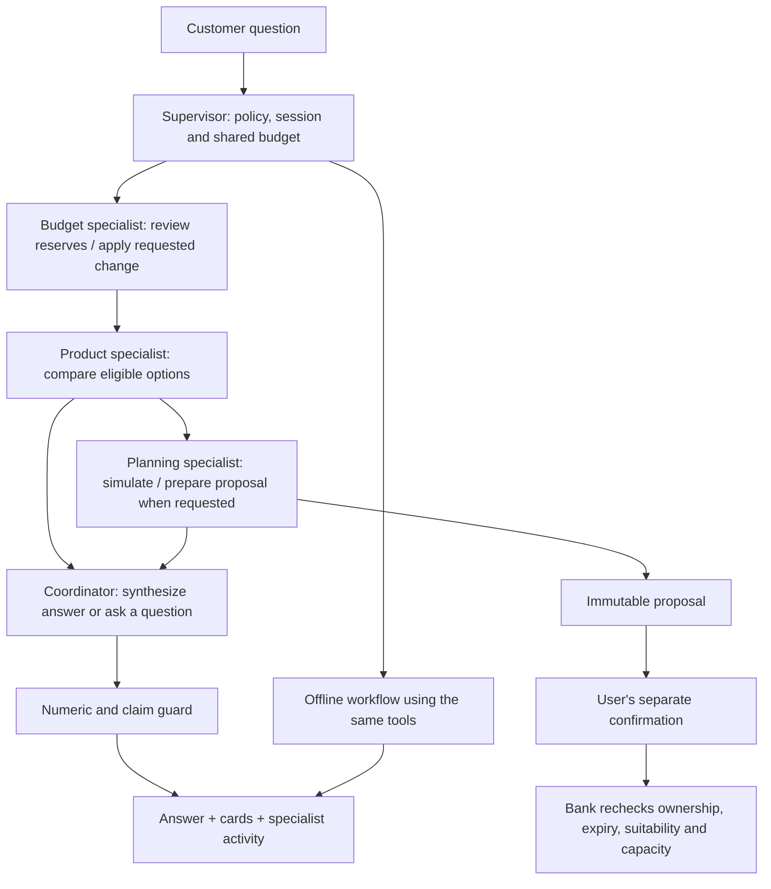

# Specialist orchestration

The app now routes financial work through a supervisor and three specialist agents. Each live role uses the configured provider/model with its own prompt, tool permissions and tool transcript. The supervisor shares verified results, collects a guarded budget finding and publishes one final customer answer. Financial work runs sequentially because product fit and plan sizing depend on the budget and current goal.



| Role | Responsibility | Model tool permissions |
|---|---|---|
| Budget | Review verified cash flow, reserve deductions and obligations; apply the customer's exact change | `what_if` when a change is pending. Profile, spending, capacity and explicit risk are supplied by trusted application reads. |
| Products | Compare products against the current customer context | `compare_products` |
| Planning | Simulate options and prepare a checked proposal when requested | `simulate`, `propose_plan`; explicit product ID required, eligible product enum and affordable ceiling supplied to the model |
| Coordinator | Combine findings, explain the trade-off and handle the customer conversation | Authenticated: `handoff_to_adviser` only when the user requests an adviser. Anonymous: educational `simulate`, `request_authentication`, and a requested adviser handoff. |

Role permissions are enforced before tool execution, independently of the prompt. An attempted cross-role tool call returns `SPECIALIST_TOOL_DENIED` and is audited. Planning calls must name an eligible product explicitly when preparing a plan; a missing product ID cannot silently select the simulator's default fund. Completed planning actions are removed, and ladder contributions are constrained to zero because the allocation is one-off. The bank still validates every proposal and confirmation independently.

## Context and handoffs

The supervisor instance is created per turn and customer. It holds a current-turn board of tool results, agent stages and a guarded budget finding. Each specialist sees the last customer-facing conversation messages, its own tool exchanges, recorded journey facts and the verified board. Other specialists' tool transcripts and rejected draft replies are filtered out. Reused provider tool-call IDs do not determine ownership; server-side agent tags do.

A budget finding must pass the numeric/claim guard before it can reach another specialist. Private findings and model thinking are not returned in activity events, API results or audit records. The coordinator's final answer passes the same guard. The shared board contains actual scoped tool results, including a refreshed capacity result after `what_if`; it does not depend on a specialist inventing or copying financial figures correctly.

A successful comparison routes to planning when simulation/proposal work is needed, otherwise to the coordinator. An unknown risk preference blocks fund proposals at the bank. A change of goal routes back through budget and product checks. Proposal activation still requires `POST /api/proposals/:id/confirm` with explicit user confirmation. None of the roles has an activation tool.

## Limits and failure behavior

All roles share **six provider exchanges, twelve seconds and the configured total-token budget for the entire turn**. Limits do not reset at a handoff. Scope errors, retries and rejected findings consume that same allowance. Cancellation aborts the pending provider call and does not start the offline planner. Timeout, provider failure, exhausted budget or repeated guard failure switches the turn to offline mode.

Offline mode routes the deterministic planner's existing tools through the same budget/product/planning roles and coordinator. Its activity explicitly says `offline` and records **zero model calls**. A partially completed change is not applied twice on fallback. A policy refusal does not invoke any specialist model.

## Run and inspect

Specialist orchestration is enabled by default:

```dotenv
AGENT_ORCHESTRATION=1
AGENT_PROVIDER=bedrock
AWS_REGION=us-west-2
AGENT_MODEL=us.amazon.nova-pro-v1:0
```

Supply the existing Bedrock API key securely in environment settings or the ignored `.env`. Anthropic and OpenAI-compatible adapters use the same supervisor interface. Restart `npm start` after configuration changes. `AGENT_ORCHESTRATION=0` selects the previous single-agent loop. No new dependency, service, credential type or build step is required.

Select a persona, ask “I want a balanced plan”, and open **Agent activity → Your specialist team**. The panel shows agent starts/completions, handoffs, tool ownership, durations, actual mode and model-call counts. Try “I need the money for a car in 2 years” to see budget → products → planning route again.

JSON responses include `orchestration.strategy`, `orchestration.stages` and `orchestration.handoffs`. Fetch/SSE emits `agent_start`, `agent_complete`, `agent_handoff`, existing tool events and exactly one final `done`. Stage audit contains role, mode, decision, timing and reported tokens, without conversation text or private findings. `/admin` includes specialist-stage counts alongside the existing funnel and costs.

## Verification

- `npm test`: existing regression suite plus role isolation, unauthorized tool attempts, required planning inputs, guarded handoffs, concurrent-customer isolation, global timeout/token/iteration behavior, cancellation, offline provenance and actual SSE ordering.
- `npm run eval`: all forty scenarios exercise the supervisor with scripted specialist responses; this tests orchestration and safeguards, not model reasoning quality.
- `AGENT_PROVIDER=bedrock AGENT_MODEL=us.amazon.nova-pro-v1:0 npm run eval -- --live`: real specialist providers, with every fallback counted as a live quality failure. See [EVAL_REPORT.md](EVAL_REPORT.md) for current measurements and failures.
- [Browser evidence](orchestration-browser-evidence.json): English desktop, Romanian phone, explicit confirmation and automated accessibility checks using throwaway tooling outside the application.
- [Live browser evidence](orchestration-live-browser.json): actual Bedrock calls by all four roles, visible handoffs and zero activations before user confirmation.

The supervisor uses a deterministic routing policy; specialist models choose their permitted tools and the coordinator writes the reply. Reported latency and quality depend on the provider/model. The server process hosts the roles and coordinates financial work sequentially. Production deployment still requires the durable storage and access controls described in ARCHITECTURE.md.
